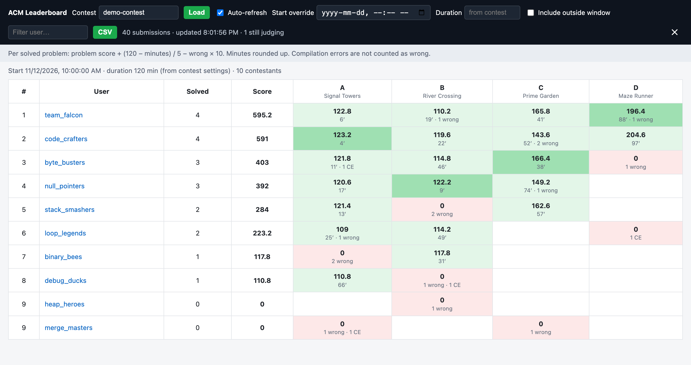
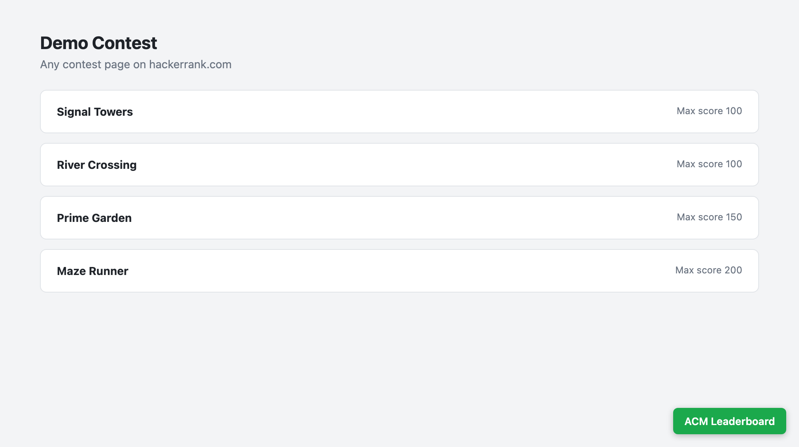

# HackerRank ACM Leaderboard

A Chrome extension that rebuilds a HackerRank contest leaderboard straight from the judge submissions.

HackerRank's built-in ACM leaderboard has become unreliable. This extension ignores it: it reads every submission in the contest and computes the ranking itself, using a time-weighted scoring rule. It was built for the National Schools' Software Competition (NSSC) in Sri Lanka, but it works for any HackerRank contest you moderate.



*Screenshot from the bundled demo with made-up teams. See [Try it without HackerRank](#try-it-without-hackerrank).*

## Features

- Reads the contest's start time, end time, problems and point values automatically.
- Shows the score, solve minute, wrong attempts and compilation errors for every contestant and problem.
- Highlights the first team to solve each problem.
- Auto-refreshes every 30 seconds during a contest.
- Filters by username and exports to CSV.
- Start time and duration overrides for re-scoring past contests.
- Runs entirely in your browser. It only sends read-only requests to hackerrank.com and sends no data anywhere else.

## Requirements

- Google Chrome or another Chromium browser (Edge, Brave, Arc).
- A HackerRank account that is a **moderator or owner of the contest**. HackerRank only lets moderators read everyone's submissions. Ordinary contestants get an error.

## Install

### From a release (recommended)

1. Download `hackerrank-acm-leaderboard-vX.Y.Z.zip` from the [latest release](https://github.com/lakshith-403/Hackerrank-ACM-Leaderboard-Extension/releases/latest) and unzip it.
2. Open `chrome://extensions`.
3. Turn on **Developer mode** (top-right toggle).
4. Click **Load unpacked** and select the unzipped folder, the one that contains `manifest.json`.

### From source

```bash
git clone https://github.com/lakshith-403/Hackerrank-ACM-Leaderboard-Extension.git
```

Then follow steps 2–4 above and select the cloned folder.

To update later, replace the folder (or `git pull`), then click the ↻ reload icon on the extension's card in `chrome://extensions`. Refresh any open HackerRank tabs afterwards.

## Usage

1. Sign in to HackerRank with your moderator account.
2. Open any page of the contest, for example `https://www.hackerrank.com/contests/<contest-slug>/challenges`.
3. Click the green **ACM Leaderboard** button in the bottom-right corner.

   

4. The leaderboard opens over the page and loads straight away. The contest slug is taken from the URL, and you can type a different one into the **Contest** box.
5. During a live contest, tick **Auto-refresh**.
6. Close the overlay with **✕**. The button stays on the page so you can reopen it.

### Controls

| Control | What it does |
|---|---|
| **Contest** | The contest slug, the part after `/contests/` in the URL. Press Enter or **Load** to fetch it. |
| **Auto-refresh** | Reloads the submissions every 30 seconds. |
| **Start override** | Uses a different start time (your local time zone). For past contests whose start time was edited afterwards. |
| **Duration** | Contest length in minutes. Leave it blank to use the contest's own end − start. |
| **Include outside window** | Also counts submissions made before the start or after the end, with their times clamped into the contest. For testing only. |
| **Filter user…** | Shows only usernames containing the text. Ranks don't change. |
| **CSV** | Downloads the current leaderboard as a spreadsheet. |

The status line shows how many submissions were loaded and how many are still being judged. It also shows how many fall outside the contest window. Those are ignored unless you tick **Include outside window**.

### Reading the table

| Cell | Meaning |
|---|---|
| Light green | Solved. Shows the points earned, the minute it was solved, and any wrong attempts or compilation errors (CE) before it. |
| Dark green | Solved, and this contestant solved it first. |
| Red | Attempted but not solved. Shows wrong attempts and CEs. |
| Empty | Not attempted. |

## Scoring

For every solved problem:

```
points = problem score + (duration − minutes) / 5 − wrong attempts × 10
```

- **problem score**: the challenge's max score in the contest settings.
- **duration**: the contest length in minutes, from its start and end times. If the contest has no end time, it falls back to 120. You can override it in the UI.
- **minutes**: minutes from the contest start to the first Accepted submission, with any part of a minute rounded up (4 min 10 s counts as 5).
- **wrong attempts**: rejected submissions before the first Accepted. Compilation errors are **not** counted. Submissions after the first Accepted don't count.
- Unsolved problems score 0.
- Submissions outside the contest window and submissions still being judged are ignored.

Contestants are ranked by total points, then by problems solved, then by the earlier last-solve minute. Contestants who are equal on all three share a rank.

### Changing the rule

The rule lives in `HRACM_CONFIG` at the top of [`leaderboard.js`](leaderboard.js):

```js
const HRACM_CONFIG = {
  DEFAULT_DURATION: 120,  // minutes, used only if the contest has no end time
  TIME_BONUS_DIVISOR: 5,  // (duration − minutes) / 5
  WRONG_PENALTY: 10,      // points lost per wrong attempt
  NOT_PENALISED: new Set(['Compilation error']), // statuses that aren't wrong attempts
  ...
};
```

Edit it, then reload the extension in `chrome://extensions`. To count compilation errors as wrong attempts, change `NOT_PENALISED` to `new Set()`.

## Try it without HackerRank

[`demo/index.html`](demo/index.html) runs the real extension code against a made-up contest. [`demo/mock.js`](demo/mock.js) stands in for HackerRank's API. Open the file in Chrome, or serve the repo and visit `/demo/`:

```bash
python3 -m http.server 8000
```

The screenshots in this README were taken from it.

## How it works

The extension is a content script on `www.hackerrank.com`. All requests are same-origin and use your existing session cookie, so you never enter credentials and the extension has no special permissions. It calls these internal, undocumented endpoints:

| Endpoint | Fields used |
|---|---|
| `GET /rest/contests/{slug}` | `model.epoch_starttime`, `model.epoch_endtime` |
| `GET /rest/contests/{slug}/challenges?offset=&limit=50` | `models[].slug`, `name`, `max_score`, `total` |
| `GET /rest/contests/{slug}/judge_submissions/?offset=&limit=500` | `total` and `models[]`: `id`, `hacker_id`, `hacker_username`, `challenge.slug`, `challenge.name`, `status`, `created_at` (epoch seconds), `kind` |

`judge_submissions` returns submissions newest first. The extension pages through all of them and removes duplicates. Status values seen include `Accepted`, `Wrong Answer`, `Compilation error`, `Runtime Error` and `Segmentation Fault`. Anything that looks like `Processing` or `Queued` is treated as still being judged.

Because these APIs are internal, HackerRank can change them without notice. If the leaderboard stops loading, check them in your browser's DevTools → Network tab first.

### Project layout

```
manifest.json      Manifest V3, a content script on www.hackerrank.com
leaderboard.js     Fetching and scoring (HRACM.load / HRACM.compute)
content.js         The button and the leaderboard overlay
leaderboard.css    Overlay styles
demo/              Offline demo with mocked API responses
docs/images/       README screenshots
```

## Troubleshooting

| Problem | Fix |
|---|---|
| No button on the page | Check the extension is enabled in `chrome://extensions`, then refresh the HackerRank tab. |
| `Error: 403` or `401` | The signed-in account isn't a moderator of this contest. |
| "No submissions counted yet" but there are submissions | They are outside the contest window. That's usual before a contest starts, when only test submissions exist. Use **Include outside window** or **Start override** to see them. |
| Scores for an old contest look wrong | Its start or end time was probably edited after the contest. Set **Start override** and **Duration** to the real values. |

## License

[MIT](LICENSE). This project is not affiliated with or endorsed by HackerRank.
